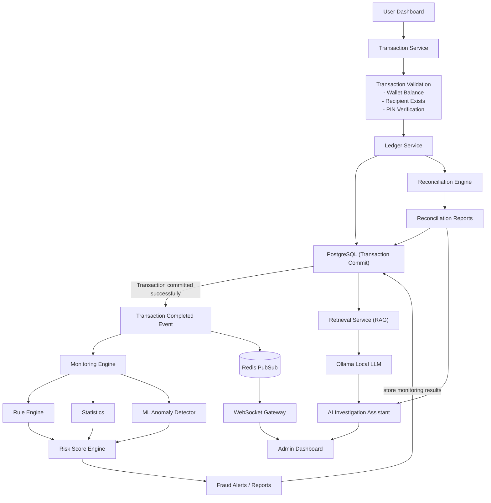

# Sentinel

Sentinel is a real-time transaction monitoring platform. On the surface it is a simple,
GPay/PhonePe-style peer-to-peer payment app built on a virtual currency (ST Coins). Underneath,
every transaction is evaluated by a monitoring engine that validates the ledger, reconciles
accounts, detects fraud from behavior (never from manual labels), scores anomalies with a
trained ML model, forecasts which accounts are trending toward risk, and can explain any of it
on demand through a local-LLM AI Investigation Assistant.

See [idea.md](idea.md) for the full product vision this implementation follows.

## Tech stack

| Layer | Choice |
|---|---|
| Backend | FastAPI, SQLAlchemy, Alembic, PostgreSQL, Redis |
| Frontend | React + Vite + TypeScript + Tailwind CSS, React Router |
| Real-time | Native WebSockets, fed by Redis Pub/Sub |
| ML | scikit-learn (Isolation Forest), pandas, joblib |
| AI Assistant | Local LLM via [Ollama](https://ollama.com) (`llama3.2:1b` by default) - no external API keys |
| Scheduling | APScheduler (reconciliation + predictive analytics jobs) |
| Testing | pytest (backend), Vitest + React Testing Library (frontend) |

## Architecture



See [docs/ARCHITECTURE.md](docs/ARCHITECTURE.md) for the full breakdown, including the
Architecture Rules every feature is built to follow.

## Quickstart (Docker)

Requires Docker Desktop.

```powershell
copy .env.example .env
cd docker
docker compose up -d postgres redis ollama backend frontend
docker exec sentinel_ollama ollama pull llama3.2:1b
```

- Frontend: http://localhost:5173
- Backend API docs (Swagger): http://localhost:8000/docs
- Ollama: http://localhost:11434

Seed an admin account (there is no public admin signup, by design):


> **Note:** if you change frontend dependencies after the container was first built, its
> `node_modules` anonymous volume goes stale. Refresh it with:
> `docker compose up -d --force-recreate --renew-anon-volumes frontend`

## Local development (without Docker)

### Backend

```powershell
uv venv --python 3.11 .venv
uv pip install --python .venv\Scripts\python.exe -r requirements.txt
```

Start Postgres/Redis via `docker compose up -d postgres redis` (backend/`.env` points at the
host-mapped port `5433` for Postgres to avoid conflicting with any locally installed Postgres
on `5432`).

```powershell
cd backend
..\.venv\Scripts\python.exe -m alembic upgrade head
..\.venv\Scripts\python.exe -m uvicorn app.main:app --reload
```

### Frontend

```powershell
cd frontend
npm install
npm run dev
```


## Testing

```powershell
# Backend (uses a separate `sentinel_test` database and a separate Redis DB index)
.venv\Scripts\python.exe -m pytest tests/ -v

# Frontend
cd frontend
npm run test
npm run lint
```

## Synthetic data & the ML Anomaly Detector

The ML Anomaly Detector is trained offline on synthetic data generated by running the *real*
transaction pipeline (not synthetic rows inserted directly into the database), so the
Monitoring Engine evaluates simulated behavior exactly as it would evaluate a real user:

```powershell
cd backend
..\.venv\Scripts\python.exe ..\ml\synthetic_generator.py --normal-users 30 --suspicious-groups 5
..\.venv\Scripts\python.exe ..\ml\train_model.py
```

This writes `ml/artifacts/persona_labels.csv` (evaluation-only labels, never used as a training
signal or stored in the app's schema - fraud emerges from behavior, never from labels) and
`backend/app/ml_artifacts/anomaly_model.joblib`, which the backend loads automatically on next
transaction if present. See [ml/retrain_model.py](ml/retrain_model.py) for the documented path
to retraining on real accumulated platform data later - it's the same pipeline, just pointed at
more/different data.

## Project structure

```
backend/     FastAPI app (api, core, models, schemas, services, workers)
frontend/    React + Vite SPA
ml/          Synthetic data generator, feature engineering, training pipeline
docker/      docker-compose.yml
tests/       pytest suite (backend)
docs/        Architecture and development docs
```

## Known limitations / notes

- `npm audit` flags a high-severity advisory in `react-router` related to RSC (React Server
  Components) mode CSRF bypass. This app is a client-only SPA using `BrowserRouter`, not RSC
  mode, so the vulnerable code path is not exercised; a fix would require a breaking downgrade
  and was judged not worth it for this reason.
- The ML Anomaly Detector has no signal for a brand-new account's very first transaction (no
  history to compare against), so cold-start large transfers may only be caught by the Rule
  Engine's `unusually_large_transfer` rule once enough history exists - this is expected
  behavior, not a bug.
- This plan is scoped to local development via `docker-compose`; no cloud deployment
  configuration is included.
